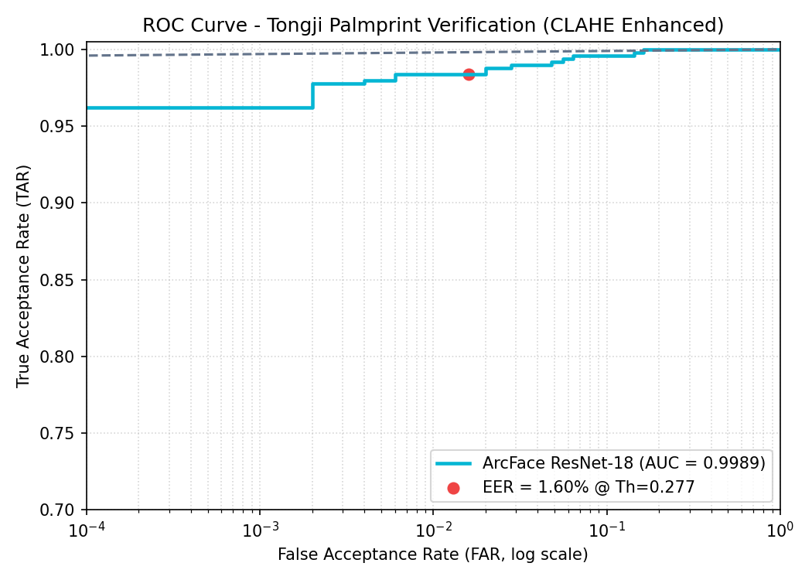

# 🖐️ ArcFace Palmprint Verification (Tongji Dataset)


A high-performance, end-to-end Contactless Palmprint Verification pipeline utilizing **ResNet-18** as the backbone and **Additive Angular Margin Loss (ArcFace)** for robust feature extraction. This model is specifically fine-tuned and evaluated on the **Tongji Contactless Palmprint Dataset** with **CLAHE** (Contrast Limited Adaptive Histogram Equalization) enhancement.

## 📊 Performance Highlights
Our model achieves state-of-the-art results on the test set:
*   **AUC (Area Under Curve):** `0.9989`
*   **EER (Equal Error Rate):** `1.60%`
*   **Optimal Decision Threshold:** `0.2773`





## ✨ Key Features
*   **Backbone:** ResNet-18 (Pretrained on ImageNet).
*   **Loss Function:** ArcFace (Additive Angular Margin Loss) for highly discriminative 512-D embeddings.
*   **Preprocessing:** CLAHE enhancement for sharpening palm lines. Removed aggressive Zhang ROI since the Tongji dataset is already pre-cropped (128x128).
*   **Mixed Precision Training:** Faster training with `torch.amp.autocast`.
*   **Synthetic Fallback:** If the original dataset is missing, the notebook automatically generates synthetic palmprints for zero-crash dry runs.
*   **1:1 Verification:** Ready-to-use inference function for comparing two palmprint images.

## 🛠️ Installation & Setup

1. **Clone the repository:**
   ```bash
   git clone https://github.com/your-username/ArcFace-Palmprint-Verification.git
   cd ArcFace-Palmprint-Verification
```

2. Install dependencies:
   It is recommended to use a virtual environment.
   ```bash
   pip install -r requirements.txt
   ```

🚀 Usage

1. Training & Evaluation

You can run the provided Jupyter Notebook (palmprint_verification.ipynb). The notebook is designed to run seamlessly on Kaggle or Google Colab with GPU acceleration.

· Dataset: The script automatically detects the Tongji dataset. If not found, it generates synthetic data to let you test the pipeline immediately.
· Training: Run all cells sequentially. The training loop saves the best model based on the lowest validation EER.

2. 1:1 Palmprint Verification (Inference)

Use the verify_two_palms() function to compare two palmprint images. The function automatically loads the optimized threshold from outputs/threshold.json.

```python
from src.verify import verify_two_palms # Adjust import based on your structure

img1_path = "path/to/session1/image_001.bmp"
img2_path = "path/to/session2/image_001.bmp"

result = verify_two_palms(img1_path, img2_path)

if result['match']:
    print("✅ SAME PERSON (MATCH)")
else:
    print("❌ DIFFERENT PERSON (IMPOSTOR)")
```

📁 Repository Structure

```text
├── notebooks/               # Jupyter Notebooks for training & evaluation
├── outputs/                 # Saved ROC curves and threshold.json
├── checkpoints/             # Saved model weights (.pth)
├── requirements.txt         # Python dependencies
├── LICENSE                  # MIT License
└── README.md                # Project documentation
```

📈 Evaluation Results

The model was evaluated on a person-disjoint test set.

· True Acceptance Rate (TAR) is plotted against the False Acceptance Rate (FAR) on a logarithmic scale.
· The EER point is achieved at a cosine similarity threshold of 0.2773.

🤝 Contributing

Contributions, issues, and feature requests are welcome! Feel free to check the issues page.

📜 License

This project is licensed under the MIT License. See the LICENSE file for details.

🙏 Acknowledgements

· Tongji University for the Contactless Palmprint Dataset.
· The original authors of the ArcFace paper.
· PyTorch and Torchvision teams.

---

If you find this project useful, please consider giving it a ⭐ (star)!
